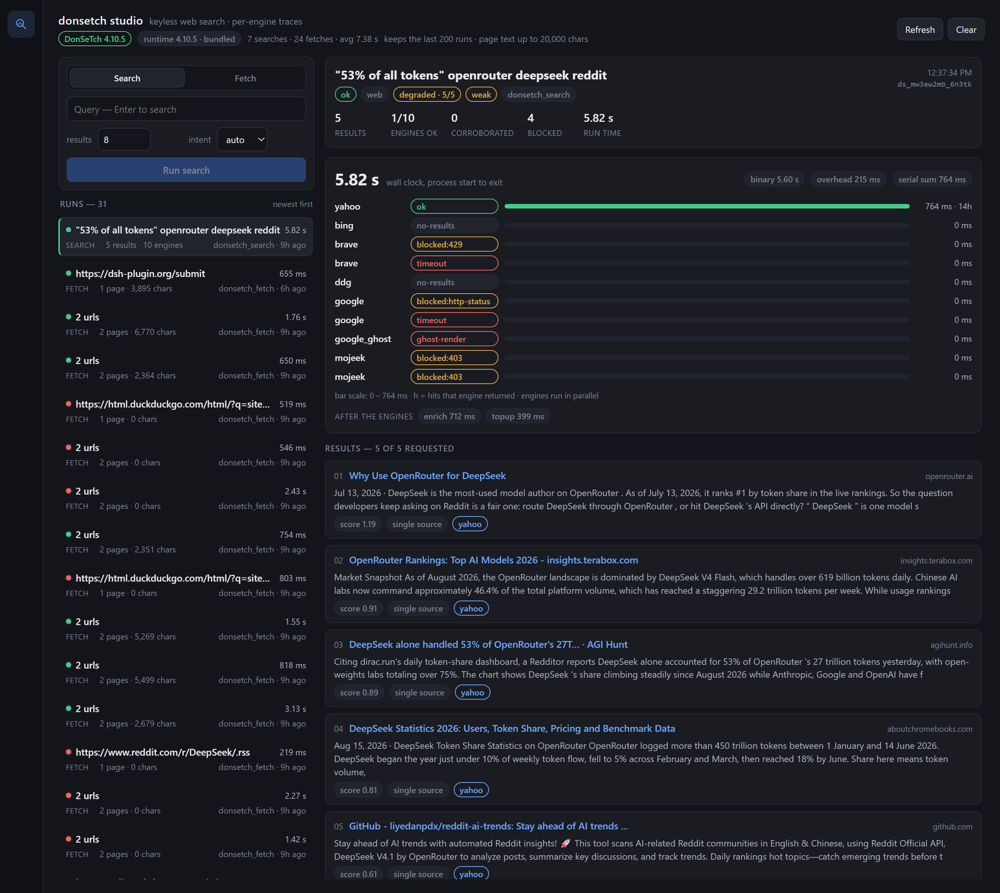
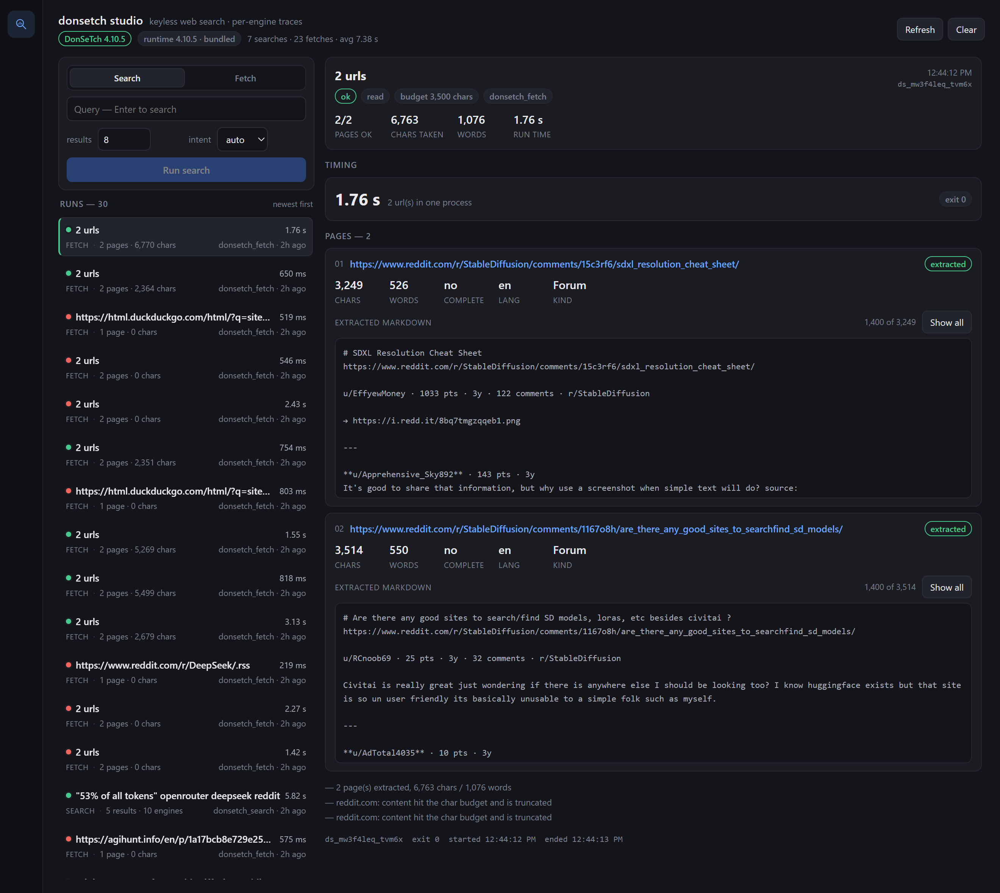

# donsetch studio

[donsetch](https://github.com/dondai44423/donsetch) as a DeepSeek Harness plugin, with a panel that
shows what actually happened during a run: which engines answered, which were blocked, what each
page gave you, and how long every step took.

A list of results on its own doesn't tell you much. When a query comes back thin, you want to know
whether the other engines were blocked, slow, or just had nothing. That's what the panel is for.

## Tools

| tool | what it does |
| --- | --- |
| `donsetch_search` | search the web, code, papers or news without an API key. Returns results with the engines that produced each one. |
| `donsetch_fetch` | fetch up to 12 URLs as markdown. Options for mode, tier, table of contents, links, and how much text to keep. |
| `donsetch_engines` | how each engine has been behaving across the runs recorded so far. |

## The panel



Pick a run on the left and read it on the right. For searches that means the wall time next to the
binary's own `meta.elapsed_ms`, a bar per engine coloured by status, how many results came back and
how many engines were blocked, the enrichment and top-up stages, and the markdown the tool returned.



For fetches you get one card per page: characters and words, whether the extraction was complete,
language and content kind, the HTTP status, the escalation trail from plain HTTP up to the headless
browser, and the markdown that came out.

You can also start a search or a fetch from the panel. It goes through the same code as the tools.

Timings are measured around the child process with `process.hrtime.bigint()`, so they include
startup. That's the number a caller actually waits for. The binary's internal number sits next to
it, and the gap between the two is part of the point.

## Install

The package is a bundle, so installing it adds the dependency and turns on `donsetch-studio` in the
profile's `cordis.patch.yml`.

```sh
dsh plugin --profile <profile> add github:santera-pixel/donsetch-studio
```

In the app, open Settings → Plugins and paste `github:santera-pixel/donsetch-studio`. Running the
same command with `update` picks up new commits.

There's nothing to build. The checkout is plain ESM, so pnpm cloning it is the whole install.

### The binary arrives on first use

No binary is committed here. On first use the plugin downloads the pinned upstream release for your
platform, checks it against a SHA-256 that is written into this repository, and unpacks it into
`~/.dsh/.donsetch-studio/runtime/4.10.5/bin/`. That's about 17 MB, once per machine. The first run
that pays for it carries a `setup` note in the panel, so the cost isn't a mystery.

The release also publishes a `.sha256` next to each asset, and the installer reads it as a second
opinion. It isn't trusted on its own: that file lives in the same release as the archive, so whoever
could replace one could replace both. If the published digest ever disagrees with the pinned one, the
install stops and says so rather than quietly accepting whichever version answered. Targets without a
pinned digest (Linux, macOS) still install, and the marker records them as `checksumSource:
"release"` so it's clear which trust model applied.

If you'd rather not have that happen in the middle of a search:

```sh
node node_modules/donsetch-studio/scripts/setup.mjs
```

Or point `DONSETCH_BIN` at a donsetch you already have.

### Certificates

donsetch brings its own TLS stack, and when it can't find an OS certificate store it stops with
`tls: no root certs loaded`. That turns up in sandboxes and containers more often than you'd expect.
The plugin writes Node's own roots to `node-roots.pem` in the runtime cache and passes it to the
child through `SSL_CERT_FILE`, so it works without changing anything on the host.

## Where the runs go

Runs are saved to `runs.json`, capped at the 200 most recent, in `<DSH_PROFILE_DIR>/.donsetch-studio/`
when the host sets that, otherwise `<DSH_HOME>/.donsetch-studio/`, otherwise
`~/.dsh/.donsetch-studio/`. The desktop shell exports those variables empty, so on a normal install
it lands in `~/.dsh/.donsetch-studio/runs.json`. `GET /api/donsetch-studio/state` reports the
resolved path as `ledgerPath`. A run that was still in flight when the harness stopped comes back as
interrupted instead of pretending it finished.

The panel updates over server-sent events, so a run started by the agent shows up without a reload.

## Tests

```
node test/runtime.mjs      # pinned digests, target lookup, tampered archive rejection
node test/smoke.mjs        # real search and fetch, then the host half on a fake ctx
node test/render.mjs       # renders the panel from the live /state bridge
node test/shot.mjs         # writes docs/preview-*.html for the screenshots above
```

`smoke.mjs` needs a donsetch binary, from `DONSETCH_BIN` or the cache, same as the plugin. The other
three run on their own but are more useful once there are some runs to look at.

## Credits

The search and fetch engine is [donsetch](https://github.com/dondai44423/donsetch) by
[@dondai44423](https://github.com/dondai44423). The retrieval, extraction and ranking are all
theirs. This plugin adds the harness integration, the ledger, the panel, the pinned runtime download
and the certificate workaround. The panel uses the binary's own vocabulary for engines, stages,
escalation tiers and `content.extract`, so a run reads the same here as it does in donsetch's JSON.

## Licence

The plugin code is AGPL-3.0-only. donsetch itself is downloaded at first use from the upstream
releases and stays under its own AGPL-3.0 licence. Nothing of it is redistributed in this
repository.
